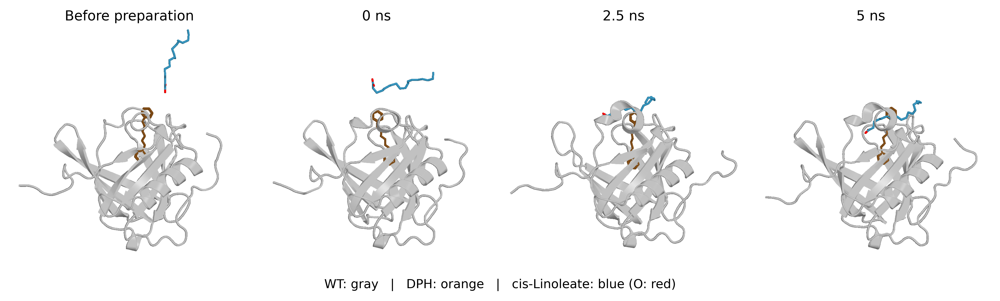
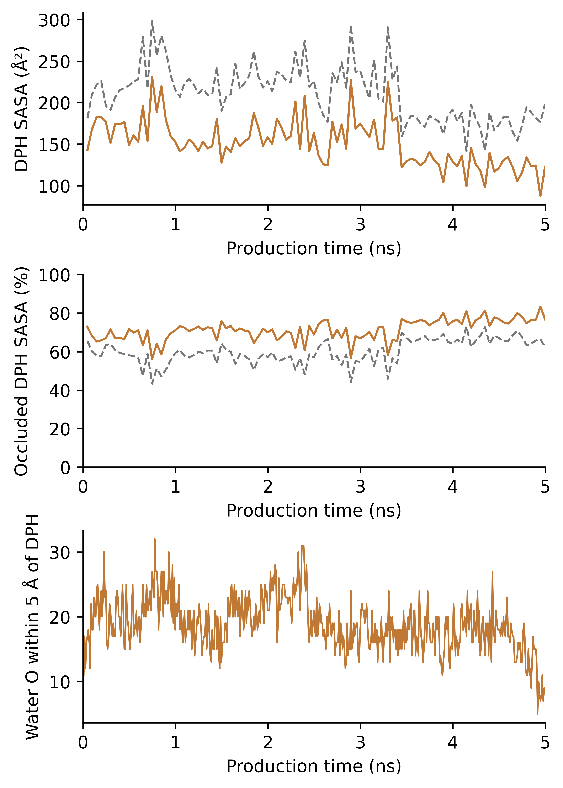
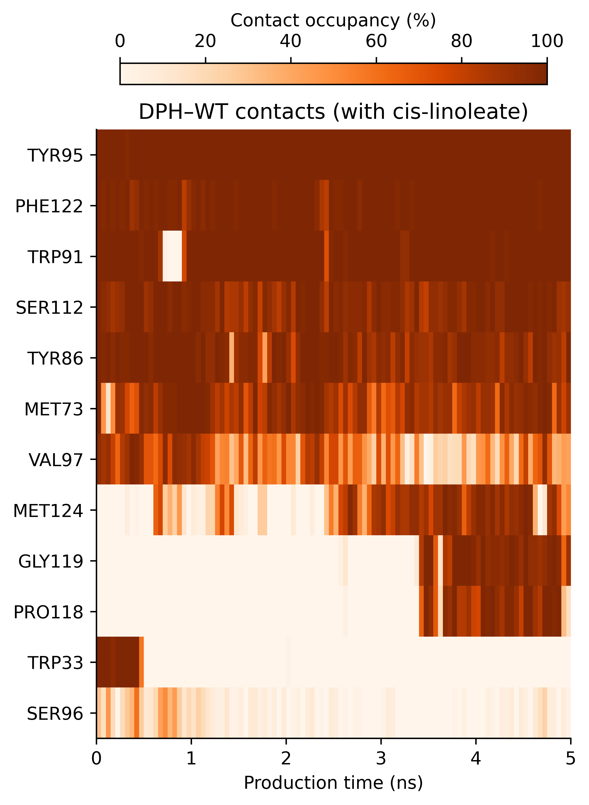

# Molecular dynamics of WT L-PGDS–DPH with cis,cis-linoleate

This module now contains the selected trajectory from the new **9Z,12Z cis,cis-linoleate batch**, original run FA_R2, CAS **60-33-3**. It supersedes the previous E/E C18:2 deposit (CAS506-21-8), which did not match the experimentally purchased reagent. Previous contents remain recoverable through Git history; no trans trajectory is presented as cis data.

## Repository contents

|Path|Contents|
|---|---|
|inputs/|Actual prepared ligand/system, full-precision coordinates and force-field cache|
|raw/|Complete original trajectories, states, topology, stage endpoints and thermodynamic records (restore large files first)|
|analysis/|SASA, contacts, hydration, motion, RMSF, all three batch summaries and control context|
|figures/|Full English figure sets and selected simplified orange panels|
|snapshots/|Actual aligned structures, including explicitly selected contact illustration|
|methods/|English and Chinese SI methods and English figure captions|
|scripts/|Analysis, plotting, optional numerical rerun, restore and SHA256 verification|
|provenance/|Chemical identity, starting geometry, replica/seed and selected-frame rule|

## Selected manuscript panels







Molecular panels use orange DPH, blue linoleate, gray WT and red oxygen. SASA/occlusion panels use orange solid protein+linoleate and gray dashed protein-only calculations on **identical ternary-trajectory conformations**, not separate binary-control trajectories. Legends were omitted at the author's request; axis units remain. Heatmap: DPH–WT residue contacts with linoleate present, any heavy-atom periodic distance <4.5 Å, 50 ps bins. Other-run curves are not overlaid in the selected panels. Full analyses, including linoleate–WT contacts, remain available.

## Simulation overview

One WT protein, one resident DPH and one cis-linoleate monoanion were simulated in explicit water/PBS-like ions/nominal 5% v/v DMSO. There were 55,362 atoms; Amber ff14SB/TIP3P/OpenFF Sage2.2.1 with independent AM1-BCC linoleate charges. OpenMM8.6.1, M5 Pro OpenCL single precision, 298.15K, 1bar, 1fs. Two ps safety plus500ps preparation preceded5ns unrestrained NPT; seed2026102212. The prepared WT/DPH coordinates were inherited unchanged from the selected WT–DPH endpoint. This is a local 1:1:1 millimolar model, not the experimental micromolar concentrations or8:1:10 ratio.

DPH–WT contact was100%; linoleate–WT100%; linoleate–DPH and simultaneous three-pair contact99.18%. Mean protein-only and protein+linoleate DPH SASA were211.09 and151.42Ų; nearby water oxygen count18.898. These are descriptive observations, not proof of enclosed-cavity residence, affinity or fluorescence enhancement. This representative was selected after inspection; R1/R3 summaries disclose the substantial repeat variation. Frames are correlated and are not independent experiments.

## Restore and reproduce

```bash
python3 scripts/restore_data.py
python3 scripts/verify_data.py
```

Large scientific files are stored in lossless gzip parts. No trajectory frames were removed. DATA_SHA256.csv checks restored original bytes.

```bash
python scripts/analyze_ternary.py
python scripts/plot_ternary.py
python scripts/prepare_contact_views.py
python scripts/verify_stereochemistry.py
# In a Python environment containing PyMOL/pymol2:
python scripts/render_pymol.py
python scripts/finish_presentation.py
python scripts/plot_selected_panels.py
```

The full plotting routines use the original blue-DPH/orange-linoleate palette; plot_selected_panels.py produces the requested orange-DPH simplified panels. These change derived outputs, not raw data. Optional numerical rerun: `python scripts/run_ternary.py smoke` then `production`, using OpenCL/RDKit; outputs go to reproduced_ternary/ and existing output is protected. Numerical reruns need not be bitwise identical.

[English SI methods](methods/SI_methods_EN.md) | [中文方法](methods/SI_methods_CN.md) | [English figure captions](methods/Figure_captions_EN.md) | [中文解读](结果解读_CN.md)

Original protein accession and original parent DPH-placement metadata require confirmation from primary preparation records; they are not inferred here. The original binary WT–DPH module remains separate and unchanged.
