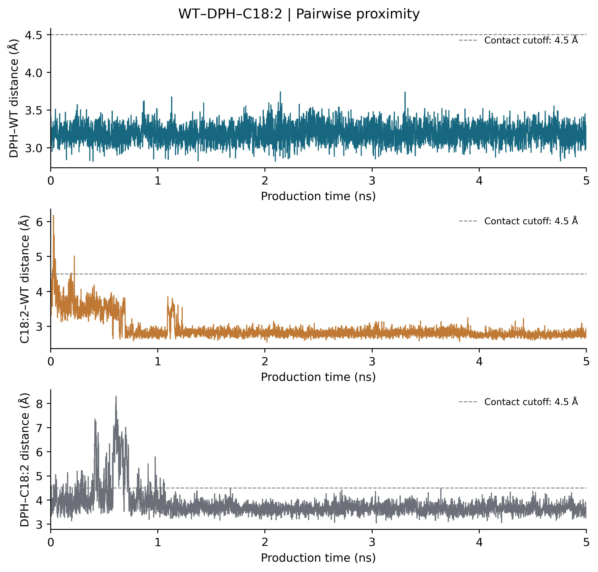
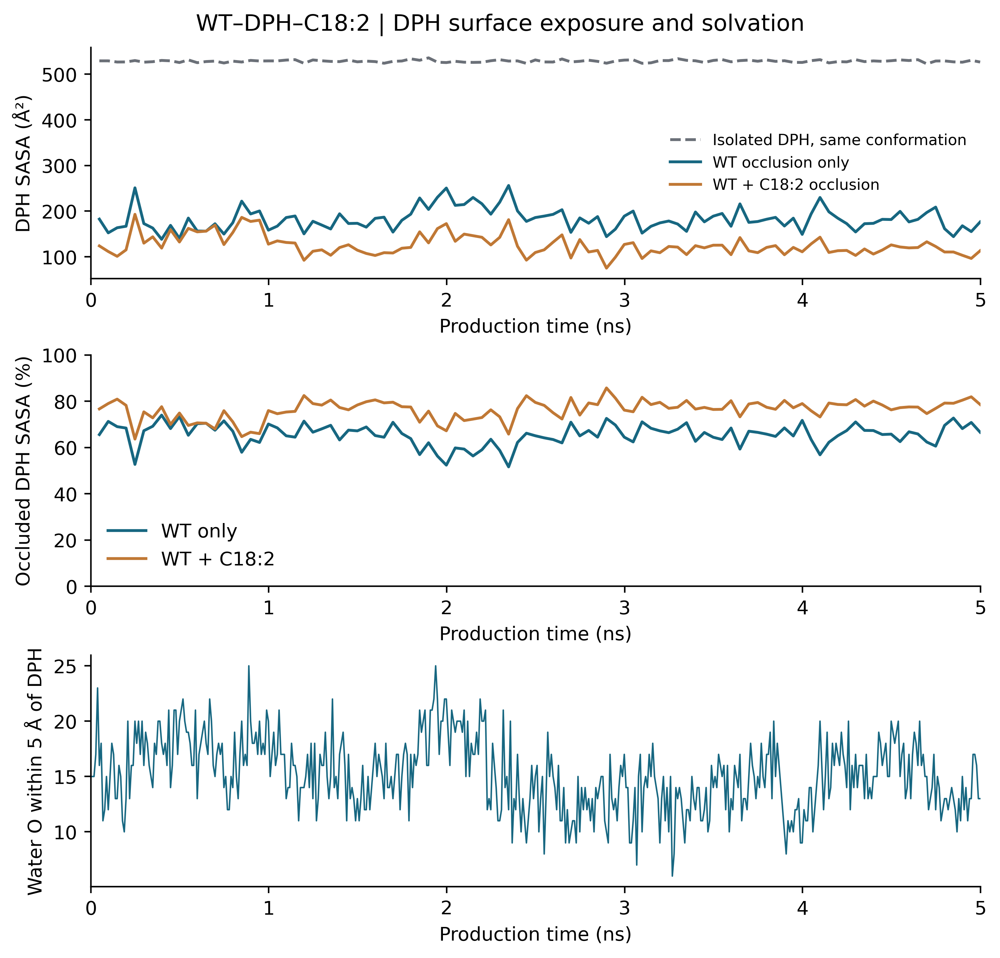
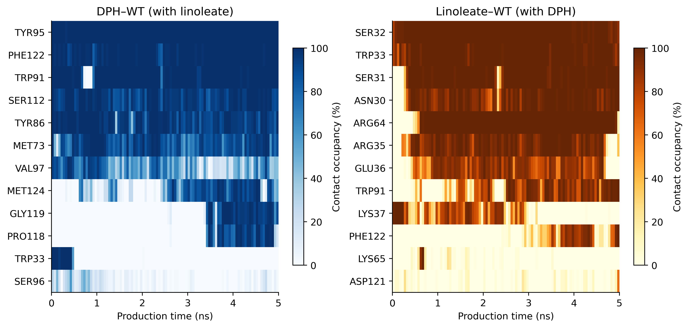

# Molecular dynamics of C18:2 near a preformed WT L-PGDS–DPH configuration

This directory provides simulation inputs, complete restorable trajectories, analysis, English figures, and reproducibility scripts for **WT–DPH–C18:2**, a 5 ns atomistic molecular dynamics trajectory of one WT L-PGDS, one DPH, and one C18:2 carboxylate. The calculation began from the final coordinates of the [WT–DPH dataset](../DPH_LPGDS_WT_MD/), after addition of an exterior fatty acid. It is a newly equilibrated branch with reassigned velocities, not a seamless extension of the parent trajectory.

The fatty acid is **(9E,12E)-octadeca-9,12-dienoate, CAS 506-21-8**, modeled as a monoanion (residue FAM). It is not the common cis,cis linoleate isomer. No PFAS molecule is present in this deposited system.

## Repository contents

| Path | Description |
| --- | --- |
| `inputs/` | Prepared DPH/FAM structures, charge and parameter records, full-precision coordinates, and restorable solvated PDB/system XML |
| `raw/` | Complete trajectories, topology, stage endpoints, checkpoint, thermodynamic records, and run status; oversized files require restoration |
| `analysis/` | Geometry, RMSD/RMSF/Rg, contacts, SASA, hydration, summary data, and small contextual summaries of FA/control repeats |
| `figures/` | Ten English figure sets in PNG (400 dpi), PDF, and SVG, without background grids |
| `snapshots/` | Aligned coordinate snapshots and PyMOL settings |
| `scripts/` | Analysis, plotting, optional numerical rerun, restoration, and verification utilities |
| `methods/` | Detailed English protocol and concise SI methodology |
| `provenance/` | FA-specific preparation record, selected task plan, and validation records |
| `DATA_SHA256.csv` | Original-file byte sizes and SHA-256 hashes |
| `LARGE_FILES.json`, `large_file_parts/` | Lossless gzip segment manifest and archived segments |

## Simulation overview

| Parameter | Recorded setting |
| --- | --- |
| Model | One WT L-PGDS, one DPH, one C18:2 carboxylate |
| Starting protein/DPH coordinates | Parent WT–DPH R3 endpoint, total parent time 5502 ps |
| Initial fatty-acid placement | Exterior; minimum WT separation 6.097 Å, DPH separation 8.160 Å |
| Force fields | Amber ff14SB; TIP3P; OpenFF Sage 2.2.1 small molecules with stored AM1-BCC charges |
| Solvent | Water, nominal 5% v/v DMSO, phosphate and PBS-like ionic composition |
| Software/backend | OpenMM 8.6.1, Apple M5 Pro OpenCL, single precision |
| Production | 5 ns unrestrained NPT, 298.15 K, 1 bar, 1 fs timestep |
| Prior preparation | 2 ps initialization test + 500 ps heating/equilibration |
| Initial box | Cubic, 82.4514 Å per edge |
| Sampling | Solute 1 ps; complete system 10 ps |
| Analysis reference | Branch pre-MD coordinates, aligned on 170 protein core Cα atoms |
| Seed | 2026102102 |

The model contains 55,359 atoms. Its effective concentrations are millimolar and its stoichiometry is 1:1:1; it does not reproduce the experimental 8 μM protein, 1 μM DPH, and 10 μM fatty acid or the 8:1:10 molecular ratio. The solvent model and finite composition are documented in the [detailed protocol](methods/SI_protocol_EN.md).

## Structural analysis

Across 5,000 production frames, DPH–WT, C18:2–WT, and DPH–C18:2 heavy-atom contacts (<4.5 Å) were observed in 100.00%, 99.62%, and 94.60% of frames, respectively. The mean occluded DPH SASA was 65.53% considering protein alone and 76.30% considering protein plus C18:2 at the same conformations. The latter difference describes additional geometric shielding by C18:2, not a measured change in fluorescence or affinity.







Each heatmap cell shows the percentage of frames in a 50 ps bin in which any ligand heavy atom was within **4.5 Å** of any heavy atom of the indicated WT residue. The left panel is DPH–WT; the right panel is C18:2–WT. These are proximity contacts, not specifically hydrogen bonds. See [all figures](figures/) and [coordinate snapshots](figures/FigS02_coordinate_snapshots.png).

This trajectory was selected after inspecting outcomes as a representative configuration of interest. The FA/control repeat summary in `analysis/FA_control_repeat_context.csv` preserves variation across the original three velocity repeats; it is not a deposit of the other raw trajectories. This selected 5 ns trajectory supports descriptive local contacts, not cooperative affinity, competition, enclosed-pocket residence, or fluorescence enhancement. The protein RMSD rises late in the trajectory; equilibrium convergence is not established. Production starts after preparation, when the fatty acid is already near DPH.

## Restore and verify original data

```bash
cd DPH_FA_LPGDS_WT_MD
python3 scripts/restore_data.py
python3 scripts/verify_data.py
```

The complete solvent/solute trajectories and XML/state files are losslessly gzip-segmented, with no archival frame removal. Restoration checks segment and original-file SHA-256 hashes. Python's standard library is sufficient for restoration.

## Analysis and computational reproducibility

After restoring data and installing the recorded scientific dependencies:

```bash
python scripts/analyze_ternary.py
python scripts/plot_ternary.py
```

The first command recalculates distance/contact/SASA/solvent analysis from the complete raw trajectories; the second generates the ten displayed figure sets and supplemental motion metrics. They overwrite derived analysis and figures, not raw trajectories. The analysis command also leaves four basic exporter plots in `analysis/`. The small contextual repeat table is archived evidence and is not reconstructed from this trajectory alone. See `scripts/requirements-analysis.txt` and the detailed protocol.

Optional MD rerun from the deposited prepared system (OpenCL and RDKit required):

```bash
python scripts/run_ternary.py smoke
python scripts/run_ternary.py production
```

The runner writes only to `reproduced_ternary/` and refuses an existing smoke-run directory or an already started production phase. Numerical trajectories need not be bitwise identical across platforms. The restored `inputs/system.xml` and `raw/running-system.xml` are the authoritative parameter records.

## Documentation

Figures and main documentation use the chemical-system name WT–DPH–C18:2. Original run identifiers remain in raw metadata and `provenance/display_naming.json` for traceability.

- [Detailed English simulation protocol](methods/SI_protocol_EN.md)
- [Supporting Information methodology](methods/SI_methods_EN.md)
- [English figure captions](methods/Figure_captions_EN.md)

Protein structural accession and original parent ligand-placement metadata remain incomplete and must be checked against primary preparation records before submission. The parent module is referenced without changing its contents.
