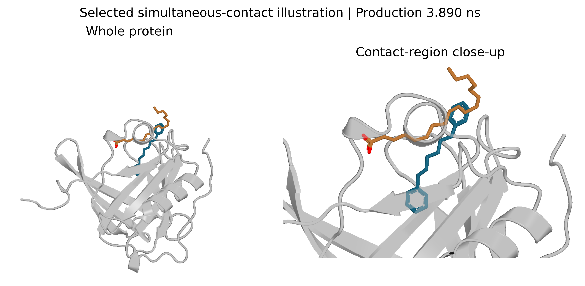
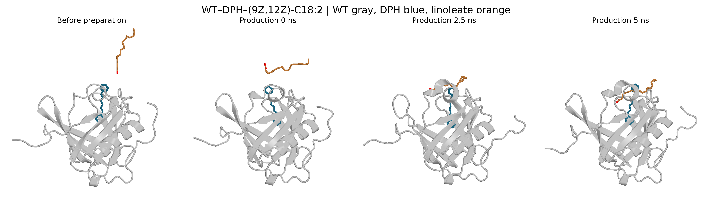
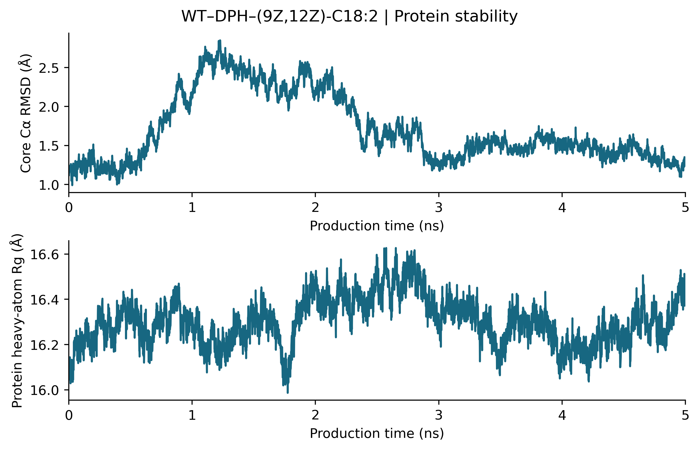
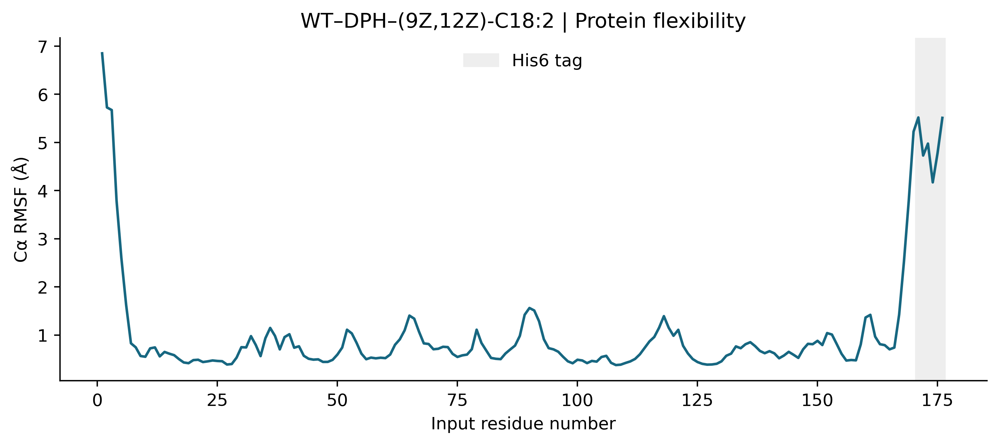
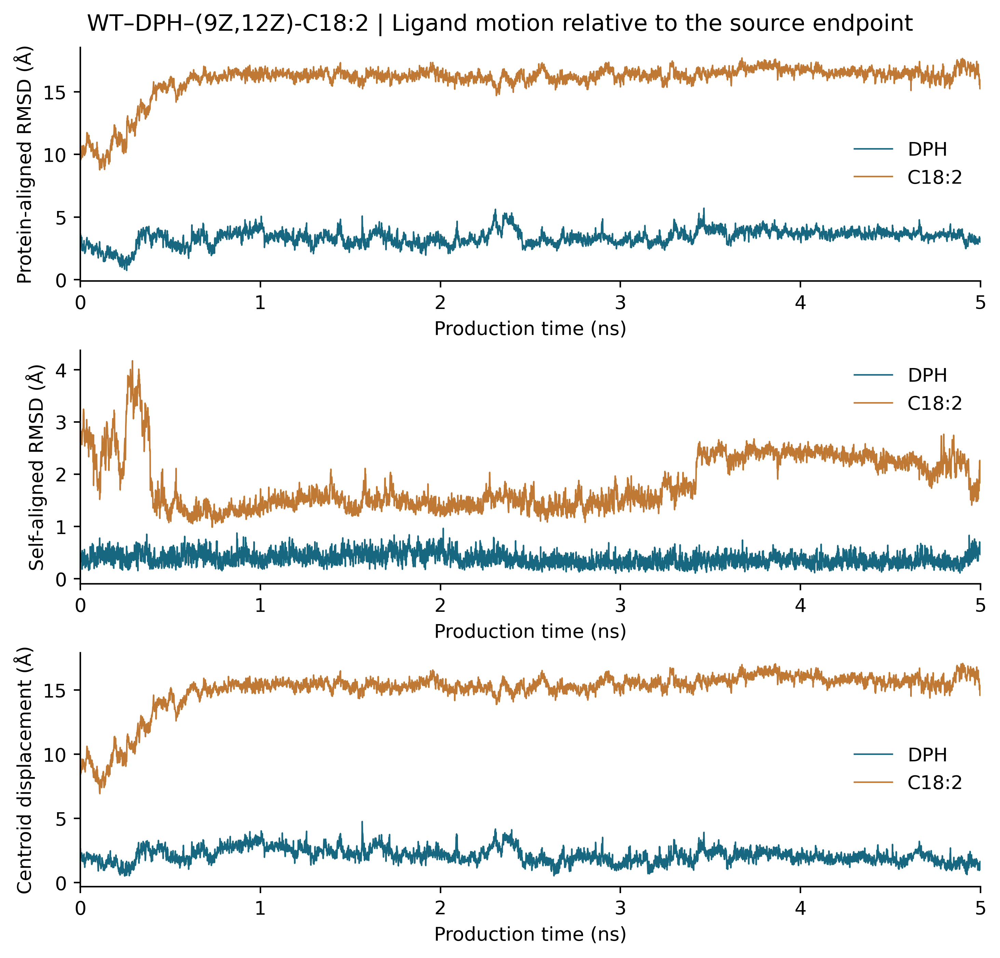
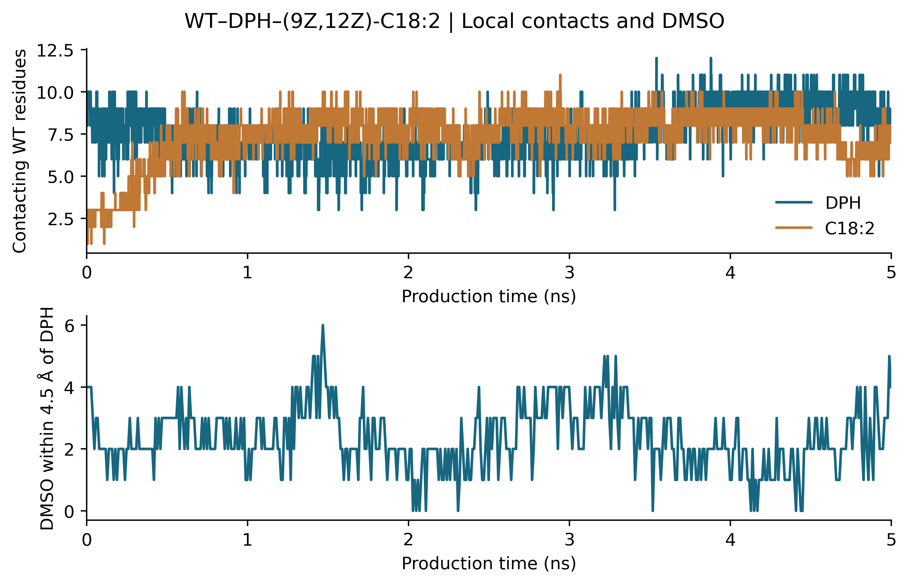
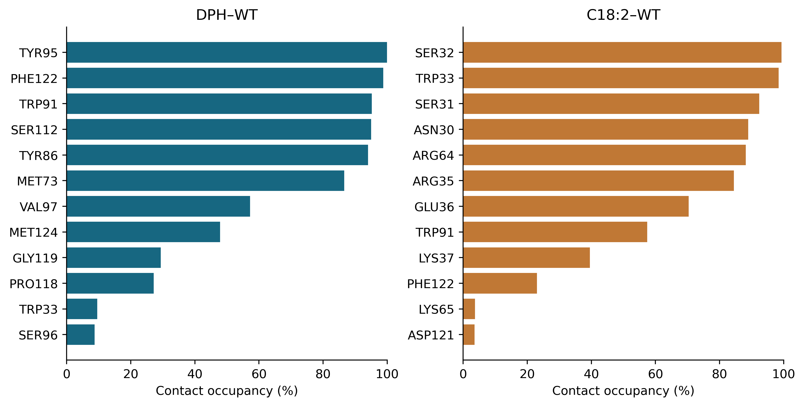
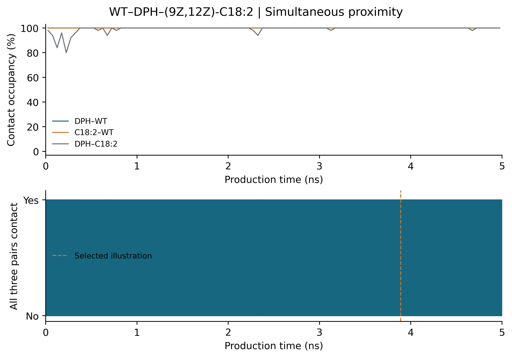
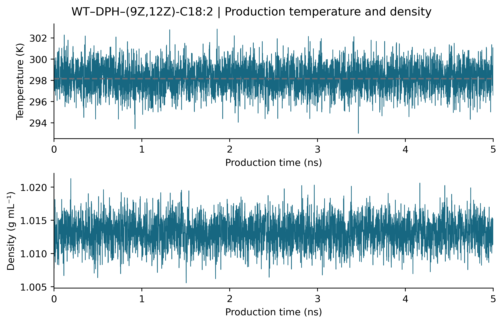
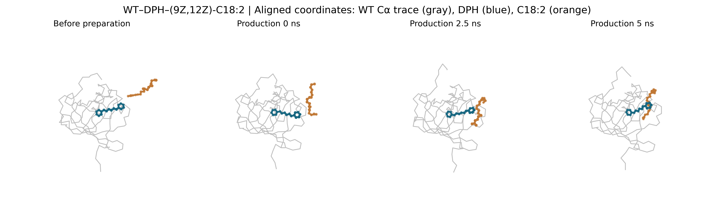

# 新批次 R2：WT–DPH–双顺式亚油酸

CAS **60-33-3，9Z,12Z**。本文件只对应新批次 FA_R2，不是早先同编号轨迹。两组分别展示，第三组结果仍保留在重复背景表中。每条正式采样5ns，5000个溶质帧；同一起点的独立速度重复。

## 关键结果

|指标|结果|
|---|---:|
|DPH–WT接触|100.00%|
|亚油酸–WT接触|100.00%|
|亚油酸–DPH接触|99.18%|
|三对同时接触|99.18%|
|最长连续严格同时接触段|1.566 ns|
|DPH末帧质心位移|1.381 Å|
|DPH SASA，仅WT遮挡|211.09 Ų|
|DPH SASA，WT+亚油酸遮挡|151.42 Ų|
|亚油酸额外几何遮挡|11.29 个百分点|
|DPH周围5 Å水氧平均数|18.898|
|核心Cα RMSD均值|1.708 Å|
|蛋白重原子Rg均值|16.302 Å|

R2 中DPH位移较小，亚油酸与WT及DPH接触更持续。这条轨迹支持持续三组分近距离接触；不能仅凭4.5 Å接触判定封闭空腔占据、亲和力或荧光增强。

## 真实接触结构

示例时间为正式 **3.890 ns**，取最长连续三对严格接触段的中点。该帧不是随机或平衡分布代表，选帧规则公开在provenance/contact_snapshot_selection.json。末帧和中间帧同时提供。

## 每张图的解释

### Fig01_pairwise_distances

三对分子的最小重原子距离；虚线4.5 Å，来自同一三元轨迹，不是二元对照。

### Fig02_protein_RMSD_and_Rg

核心170个Cα拟合的RMSD与蛋白重原子质量加权Rg；不能单凭小RMSD证明收敛。

### Fig03_protein_RMSF

相对本条正式轨迹平均构象的残基柔性；His6标签保留并标灰。

### Fig04_ligand_motion

蛋白拟合RMSD/质心位移描述相对移动；自身拟合RMSD描述内部形变。

### Fig05_DPH_exposure_and_hydration

同一DPH构象的孤立、WT遮挡、WT+亚油酸遮挡SASA，以及邻近水氧计数。

### Fig06_contacts_and_DMSO

接触蛋白残基数和DPH周围DMSO分子数；不是氢键或亲和力测量。

### Fig07_residue_contact_heatmaps

左：有亚油酸时的DPH–WT；右：有DPH时的亚油酸–WT。任意双方重原子距离<4.5 Å算接触，每格为50ps窗口内占比。

### Fig08_residue_contact_occupancy

各配体前12个残基的全程接触帧占比；与独立实验结合分数不同。

### Fig09_simultaneous_three_pair_contacts

三对同时<4.5 Å的时段；竖线标出选作结构示例的真实帧。

### Fig10_selected_contact_structure

最长连续三对接触段中点的结构示例，非任意移动分子的插图；右侧为另行放大/半透明蛋白。

### FigS01_temperature_and_density

温度、密度基本质量检查，不是充分采样或收敛证明。

### FigS02_coordinate_snapshots

准备前、正式0、2.5、5ns的统一拟合Cα轨迹图。

### FigS03_molecular_snapshots

上述四个时刻的真实PyMOL蛋白卡通图；灰WT、蓝DPH、橙亚油酸/红氧。His6仅显示时隐藏。

## 数据解读边界

SASA两种算法在相同构象下计算，差值只说明亚油酸提供的额外几何遮挡，不等于实验加入前后变化。水氧数不是氢键，也不是荧光。R2的接触更持续，但水氧数比R1高，因此不能把更持续接触自动解释成更强脱水。每条帧数有时间相关性，不作为5000个独立实验做显著性检验。原始WT–DPH二元轨迹与本图DPH–WT接触不同；本图是有亚油酸的三元体系内部指标。无脂肪酸末帧分支及本批R3的背景数据见analysis/repeat_and_control_context.csv。

## 文件

- figures/：13组英文无网格图，400dpi PNG、PDF、SVG；结构图为真实坐标栅格渲染，数值图为矢量。
- figures/structure_views/：单独结构图片及PyMOL会话。
- raw/、inputs/：完整本条原始轨迹和准备输入。
- analysis/：CSV、NPZ、SASA、水/DMSO、逐帧接触、二面角、阈值敏感性和分块统计。
- methods/：英文方法、中文条件与英文图注；scripts/可复算。
- DATA_SHA256.csv：逐文件校验。
