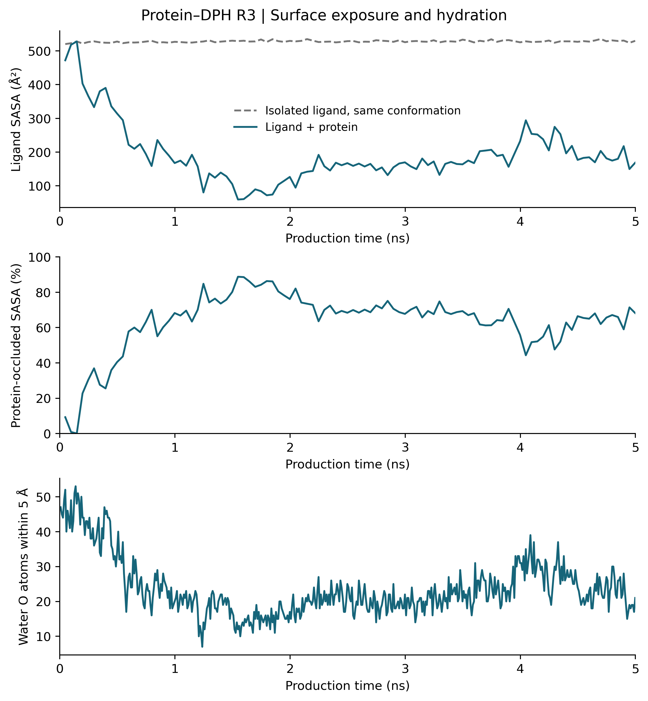
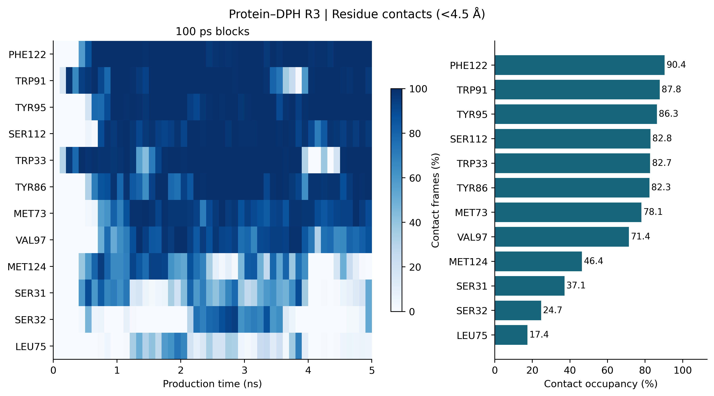

# Molecular dynamics simulation of DPH with wild-type L-PGDS

This directory provides the simulation inputs, trajectories, analysis outputs, figures, and reproducibility scripts for an atomistic molecular dynamics (MD) simulation of 1,6-diphenyl-1,3,5-hexatriene (DPH) in the presence of wild-type lipocalin-type prostaglandin D synthase (L-PGDS). The reported dataset comprises one 5 ns production trajectory following a 2 ps initialization test and 500 ps of equilibration and preparation. No fatty acids or per- and polyfluoroalkyl substances (PFAS) were included.

The DPH molecule was initially placed near the exterior of L-PGDS using a locally defined starting configuration. This simulation therefore evaluates the structural behavior of a specified protein–ligand configuration, rather than an unbiased ligand-association process starting from bulk solution. The initial closest protein–DPH heavy-atom separation was approximately 4.03 Å.

## Repository contents

| Path | Description |
| --- | --- |
| `inputs/` | Prepared ligand structure and restorable solvated coordinates and serialized force-field system |
| `raw/` | Original trajectories, topology, run status, thermodynamic records, checkpoints, and stage endpoints |
| `analysis/` | Per-frame geometry, protein fluctuations, contact metrics, solvent exposure, and solvent-neighbor data |
| `figures/` | Figures exported in PNG, PDF, and SVG formats |
| `snapshots/` | Protein-aligned coordinate snapshots and PyMOL visualization settings |
| `scripts/` | Trajectory analysis, reproducibility, restoration, and integrity-verification utilities |
| `methods/` | Detailed English MD protocol and publication-ready SI methodology |
| `legacy_analysis/` | Archived analysis outputs preserved for provenance; some reference definitions differ from the current analysis |
| `DATA_SHA256.csv` | SHA-256 checksums of original scientific files |
| `LARGE_FILES.json`, `large_file_parts/` | Manifest and lossless compressed segments for oversized original files |

## Simulation overview

| Parameter | Recorded setting |
| --- | --- |
| Model | One WT L-PGDS protein and one DPH molecule |
| Solvent | Explicit TIP3P water, DMSO, phosphate, Na+, K+, and Cl− |
| Force fields | Amber ff14SB for protein; OpenFF Sage 2.2.1 for DPH, DMSO, and phosphate |
| Software | OpenMM 8.6.1 |
| Temperature and pressure | 298.15 K and 1 bar during production |
| Production ensemble | NPT |
| Integration step | 1 fs |
| Production duration | 5 ns |
| Initial box | Cubic, 82.116 Å per edge |
| Sampling | Solute every 1 ps; full system every 10 ps |
| Production frames | 5,000 solute frames |
| Analysis reference | Prepared structure, aligned on 170 core Cα atoms |

The nominal solvent preparation targeted PBS and approximately 5% DMSO. Its discrete molecular composition and limitations are documented in the detailed [simulation protocol](methods/SI_protocol_EN.md). The single-protein/single-ligand simulated box has millimolar effective concentrations and is not a literal representation of the experimental micromolar concentrations or protein-to-dye ratio.

## Structural analysis

Across the 5,000 production frames, a protein–DPH heavy-atom contact (<4.5 Å) was observed in 4,916 frames (98.32%). The production-average protein core Cα RMSD relative to the prepared structure was 1.69 Å. Mean geometric protein occlusion of DPH solvent-accessible surface area was 63.61%, calculated using the defined SASA protocol.

These measures characterize geometric proximity and solvent shielding **within this trajectory**. They do not represent experimental binding occupancy, a dissociation constant, a binding free energy, an independently established internal-cavity residence state, or a converged estimate of a ligand entry pathway. The frames are time-correlated observations of a single trajectory.





## Restore and verify original data

Large files are stored in losslessly gzip-compressed segments to accommodate repository upload limits. The original full-solvent and solute trajectories were not subsampled for archival storage. From this directory, run:

```bash
python3 scripts/restore_data.py
python3 scripts/verify_data.py
```

Restoration reconstructs the logical original file paths, including `raw/full-trajectory.dcd`, `raw/solute-trajectory.dcd`, and `inputs/system.xml`, and verifies SHA-256 checksums. The integrity manifest distinguishes archived segments from simulation files.

## Analysis and computational reproducibility

After restoring the data and installing the software dependencies reported in the protocol:

```bash
python scripts/analyze_R3.py
```

This script regenerates derived analyses and figures; it does not generate a new MD trajectory. Some hydration plots reuse an archived solvent-neighbor table, as documented by the script.

An optional numerical rerun from the deposited prepared input can be initiated with:

```bash
python scripts/run_R3.py smoke
python scripts/run_R3.py production
```

The rerun script requires the OpenCL backend and writes to `reproduced_R3/`; it refuses to overwrite an existing output directory. Random seeds and staging parameters are recorded, but numerical trajectories need not be bitwise identical across hardware or software versions. The restored serialized `inputs/system.xml` is the authoritative record for applied potential-energy parameters.

## Documentation and reporting limitations

- [Detailed English simulation protocol](methods/SI_protocol_EN.md)
- [Publication-ready SI methodology](methods/SI_methods_EN.md)

The provenance of the original protein structural coordinates and the original ligand-placement or docking procedure is not completely recoverable from this archive. These metadata must be established from the primary preparation records before journal submission; they are not inferred here.

**Reference:** Computational and analysis data are available within this directory in the LPGDS-Sensor-Array repository.
